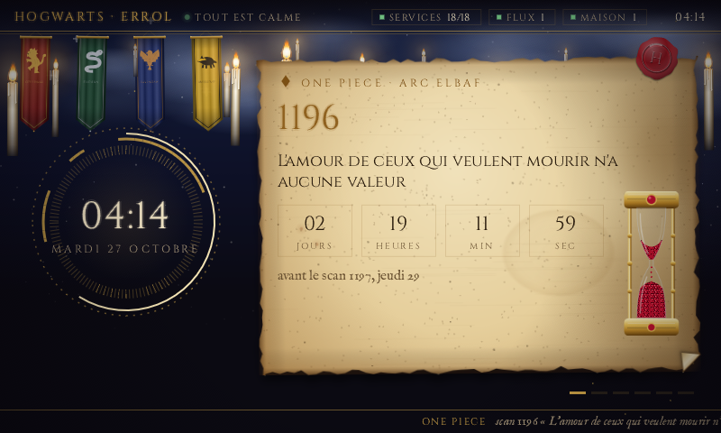
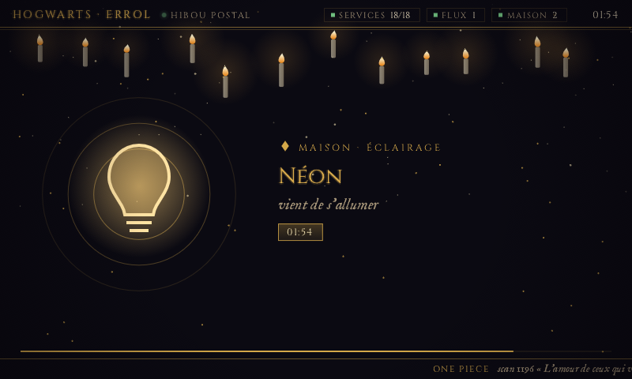

# Errol

*The family owl that brings the news: clumsy, loyal, always there.*

Errol is a living-room screen for a home server. It runs on a Raspberry Pi
with a small HDMI display (800 × 480) and shows what is happening at home:
what plays on Jellyfin, which lamp just switched on, a download that finished,
a film that entered the library, the next One Piece chapter, a trading bot's
portfolio, a Claude Code session on the Mac waiting for an answer. Something happens, and Errol takes the screen for a minute to tell
you. A film starts, and the screen turns into a cinema marquee for as long as
it plays.

It draws straight on the display with the GPU: no X, no Wayland, no browser.

| F.R.I.D.A.Y. | Cyberpunk | Hogwarts |
| :---: | :---: | :---: |
|  |  |  |
|  |  |  |

## Three looks

- **friday** is a HUD after Tony Stark's second AI. A neural network drifts
  behind the panels. Signals run along its links, and a burst fires from the
  centre when something happens.
- **cyberpunk** takes Netwatch's red and yellow. A grid runs to the horizon
  under falling columns of data, scene changes glitch, and the cinema becomes
  a braindance editor with its three tracks.
- **hogwarts** is the Marauder's Map, after Pensieve's own. On warm
  parchment with its stains, folds and burnt edges, the castle's rooms and
  corridors are drawn in faint ink; Filch, Mrs Norris, Peeves and Dumbledore
  wander about with their names on ribbons and their footprints behind them.
  The clock is Hermione's Time-Turner, its engraved ring turning, its
  hourglass emptying as the hour goes by, the time said in words under it.
  The cards are rooms of the castle, each with its door and its name on a
  ribbon, and footsteps walk from the Time-Turner to the next room when the
  carousel turns. An event is a notice of the Daily Prophet pinned to the map,
  its tags stamped in red ink; the cinema is the Prophet's front page, the
  poster its photograph, printed in sepia halftone.

The look can change while Errol runs. When the feed names a look in its
`settings`, Errol switches to it at once; this is the remote control, set
from the home page or from the projector's home screen (Pensieve), which
follows the same setting. Without one, Errol keeps its own (`--look` or
`ERROL_LOOK`). The looks' colours come from the house's `looks.json`, the
reference the hub serves at `/theme/looks.json`; `assets/looks.json` is a
copy of it, built into the binary.

## Scenes

| Scene | When | For how long |
| :--- | :--- | :--- |
| Idle | nothing else | A clock in its turning rings, and cards that slide by every 7 s: the next One Piece chapter with a countdown, the portfolio, the house, the Mac's Claude Code sessions, downloads, latest additions with their posters, the server's free space |
| Event | a lamp switches; the projection screen moves (its cloth comes down live); the projector starts or changes app; a download finishes; a film or an episode is imported; a new chapter is out; a Claude Code session waits for an answer | 25 s for a lamp, 40 s for the screen, the projector and a session, 90 s for downloads and imports, 2 min for a chapter. A new event cuts the one on screen short and shows at once; those still waiting follow it, and a burst (ten episodes imported at once) takes a single turn |
| Cinema | a video plays on Jellyfin | Until it stops: the blurred backdrop drifting, the poster in a holographic frame, the story, progress and end time |

The screen never replays the past: what happened before it started only sets
the scene.

## How it works

```
your feed  ──>  screen.json, screen/events  ──>  errol  ──>  HDMI
(any service)    (over HTTP, pushed as SSE)      (Rust, OpenGL ES, KMS/DRM)
```

Errol follows one JSON document over HTTP and draws at 30 frames per
second. The document is written by whatever knows about your home. Mine is a
small Python service that reads Jellyfin, a home hub, Transmission, Radarr and
Sonarr every 3 s and turns each change into an event. It pushes every change
on `screen/events` next to the file (Server-Sent Events), and Errol shows it
the instant it is written; without the stream, Errol reads the file every
second.

On a Raspberry Pi 4, Errol takes about **22 % of one core and 100 MB of
memory**. The first version, a web page in a kiosk Chromium, took about one and
a half cores and 700 MB for the same scenes.

### The feed

Every field is optional: Errol shows what it gets and hides the rest.

```jsonc
{
  "updated_at": "2026-10-26T22:08:53+01:00",
  "playing": [{                       // one entry per video playing on Jellyfin
    "id": "abc", "type": "movie",     // or "episode" (with "series", "season", "episode")
    "title": "Dune: Part Two", "year": 2024, "overview": "…", "genres": ["Science Fiction"],
    "runtime": 9960, "position": 1200, "paused": false,   // seconds
    "device": "Projector", "client": "Jellyfin Android TV", "user": "me",
    "poster": "/Items/abc/Images/Primary",                // Jellyfin paths or absolute URLs
    "backdrop": "/Items/abc/Images/Backdrop"
  }],
  "events": [                         // changes, oldest first; each id appears once
    {"id": "1-1", "kind": "light", "at": "…", "name": "Desk lamp", "on": true},
    {"id": "1-2", "kind": "cover", "at": "…", "name": "Screen", "cover": "screen", "moving": "down"},
    {"id": "1-3", "kind": "projector", "at": "…", "name": "Projector", "on": true, "app": "Jellyfin"},
    {"id": "1-4", "kind": "download", "at": "…", "name": "Some.Release.1080p", "size": 6400000000},
    {"id": "1-5", "kind": "import", "at": "…", "media": "episode", "title": "Arcane", "season": 2, "episode": 4,
     "episode_title": "…", "quality": "WEBDL-1080p", "poster": "https://image.tmdb.org/t/p/w342/…"},
    {"id": "1-6", "kind": "scan", "at": "…", "scan": 1197, "name": "…", "arc": "Elbaf", "pages": 17},
    {"id": "1-7", "kind": "cerebro", "at": "…", "name": "errol-8b", "project": "~/personal/errol",
     "status": "waiting", "room": "Danger Room"}
  ],
  "house": {
    "outlets": [{"id": "desk-lamp", "name": "Desk lamp", "on": true}],
    "covers": [{"id": "screen", "name": "Screen", "position": 100, "moving": null}],   // 0 up, 100 down
    "projectors": [{"id": "projector", "name": "Projector", "on": true, "app": "Jellyfin"}]
  },
  "downloads": [{"name": "Some.Release.1080p", "percent": 63.4, "eta": 1260}],
  "recent": [{"media": "movie", "title": "…", "year": 2023, "poster": "https://…"}],
  "one_piece": {"latest": {"scan": 1196, "name": "…", "arc": "Elbaf", "pages": 17},
                "next": {"scan": 1197, "at": "2026-10-29T16:00:00+01:00"}},
  "portfolio": {"name": "Bot", "mode": "paper", "equity": 1087.42, "initial": 1000, "trades": 12,
                "positions": [{"pair": "BTC/USDT", "avg": 60000, "price": 63150}]},
  "disk": {"total": 1430000000000, "used": 980000000000, "free": 450000000000},
  "services": {"up": 18, "total": 18},
  "cerebro": {"sessions": [{                // Claude Code sessions, from Cerebro on the Mac (absent while it sleeps)
    "name": "errol-8b", "project": "~/personal/errol", "status": "waiting",   // or "busy", "idle"
    "since": "…", "room": "Danger Room", "lead": "Cyclops", "agents": 0}]},
  "errors": {"house": "timeout"},     // sources the feed could not read
  "settings": {"look": "hogwarts",    // the look to show now; null keeps Errol's own
               "follow_hub": true}    // for the feed: the home page sets the look when its own changes
}
```

Picture paths that start with `/Items/` are Jellyfin's. Errol asks Jellyfin
(`--jellyfin`) for them at the size it needs.

## Run it

### Preview, on a Mac or Linux desktop

You need Rust 1.91 or later and SDL2 (`brew install sdl2`, or
`apt install libsdl2-dev`).

```sh
cargo run -p errol-app -- --demo                          # a whole made-up evening, in a window
cargo run -p errol-app -- --demo cinema --look cyberpunk  # hold one scene
cargo run -p errol-app -- --feed http://server.local/screen.json --jellyfin http://server.local:8096
cargo run -p errol-app -- --demo scan --shot scan.png --after 6   # a PNG, no window
```

The demo scenes are `idle`, `light`, `cover`, `projector`, `cinema`, `import`,
`download` and `scan`. Escape or Q closes the window.

### On a Raspberry Pi

This setup is tested on a Pi 4 running Raspberry Pi OS (Debian trixie), with
Docker and the stock `vc4-kms-v3d` overlay.

```sh
git clone https://github.com/L00rdD/errol && cd errol
sh deploy/install.sh friday        # or cyberpunk, or hogwarts
```

The script compiles inside a container (`deploy/Dockerfile`: Rust and SDL2's
headers on Debian trixie, built once and kept), so the Pi needs no Rust
toolchain. It then installs `libsdl2-2.0-0` and the binary, and runs Errol as a
systemd service on the HDMI display, as the current user. The first build
takes about 10 minutes on a Pi 4. Re-run the script after a `git pull`, or to
switch looks.

Once the Pi is set up, deploy from a Mac with Apple silicon instead:

```sh
sh deploy/push.sh                  # or: sh deploy/push.sh hogwarts
```

It builds in the same image under Docker (colima or Docker Desktop: arm64 like
the Pi, so no emulation), keeps the build in volumes, sends the binary over ssh
and restarts the service: under 20 s after a change. `ERROL_HOST` names the Pi
(`dpi.local` by default).

Settings go in `/etc/default/errol`:

| Variable | Default | |
| :--- | :--- | :--- |
| `ERROL_LOOK` | `friday` | `friday`, `cyberpunk` or `hogwarts`; the feed's `settings.look` wins when set |
| `ERROL_FEED` | `http://localhost/screen.json` | where the feed is |
| `ERROL_JELLYFIN` | `http://localhost:8096` | where Jellyfin pictures come from |
| `ERROL_FPS` | `30` | 5 to 60 |

```sh
sudo systemctl restart errol      # after a change
sudo systemctl stop errol         # gives the display back to the console
journalctl -u errol -f
```

Errol picks the display's 800 × 480 mode, or else its largest one, and fits
the stage inside.

### Screens that forget their EDID

Some small HDMI screens only send their EDID when they are on at boot. Switch
one off and on again, and the Pi is left with generic modes the screen refuses
("no signal") until the next reboot. `EDID=1 sh deploy/install.sh` installs an
EDID with the screen's own 800 × 480 timings (`deploy/make_edid.py`). It then
prints the boot parameter to add to `/boot/firmware/cmdline.txt`; the script
never edits the boot configuration itself. For another screen, read its EDID
once while it works, and change the timings in the script.

## Inside

```
crates/errol-domain   entities, ports, the scene director, use cases; no I/O, no serde
crates/errol-data     the feed's JSON models, HTTP feed and pictures, the demo, the clock
crates/errol-app      wiring, poller, picture loader, renderer, looks, backgrounds, scenes
assets/fonts          Michroma, Rajdhani and IM Fell English, built into the binary
assets/looks.json     the looks' colours, a copy of the hub's reference
deploy/               the service, the install script, the EDID generator
```

The code is in three layers:

- **The domain is pure.** `SceneDirector` decides the scene from events and a
  timestamp, so its tests need neither a clock nor a network.
- **Adapters implement the domain's ports** (`FeedSource`, `PictureSource`,
  `Clock`). The demo is a `FeedSource` like the real feed.
- **The app wires them in one place** (`injector.rs`). It reads the feed on its
  own thread and loads pictures on another. It draws with
  [femtovg](https://github.com/femtovg/femtovg) on OpenGL ES 3, through SDL2,
  on KMS/DRM.

Everything is synchronous. The only `unsafe` block hands SDL's GL functions to
femtovg.

The Map is drawn once, when the look starts. The parchment with the castle,
the Time-Turner's engraved ring and the Prophet's halftone are baked into GPU
images (`render/map.rs`, after Pensieve's own drawing). A frame then only
places images with a transform and draws a few footprints, so the look costs
no more than the others.

Before a commit:

```sh
cargo fmt --all
cargo clippy --workspace --all-targets -- -D warnings   # pedantic
cargo test --workspace
```

## Credits

- Michroma (the Michroma Project Authors), Rajdhani (Indian Type Foundry) and
  IM Fell English (Igino Marini), under the SIL Open Font License
  (`assets/fonts/OFL-*.txt`).
- The looks are fan homages to Marvel's F.R.I.D.A.Y., to Cyberpunk 2077 and
  to Harry Potter's Marauder's Map; Errol is the Weasleys' owl.
- The demo shows posters from [TMDB](https://www.themoviedb.org).

## License

MIT, except the fonts (SIL OFL 1.1).
