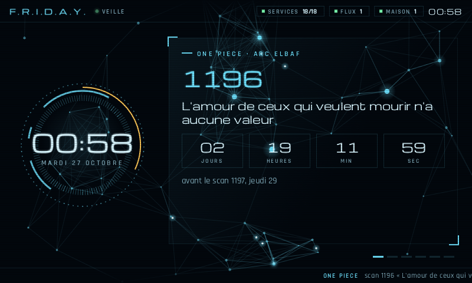
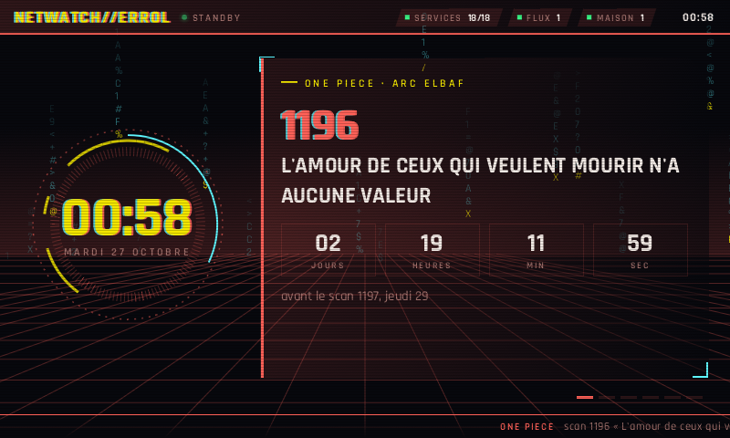
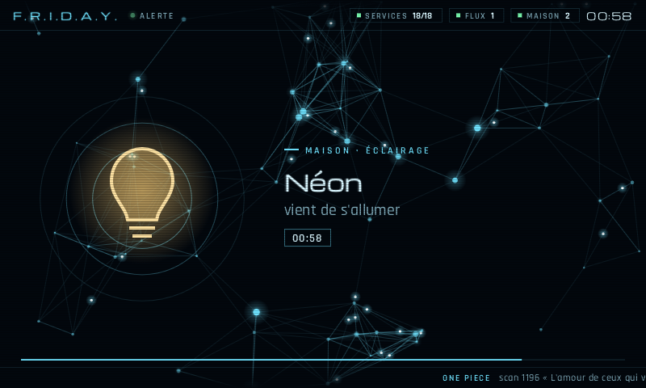
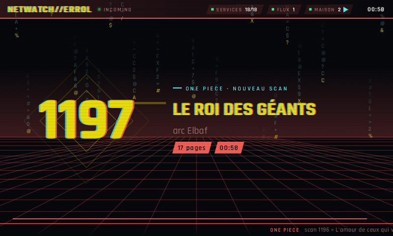

# Errol

*The family owl that brings the news: clumsy, loyal, always there.*

Errol is a living-room screen for a home server. It runs on a Raspberry Pi
with a small HDMI display (800 × 480) and shows what is happening at home:
what plays on Jellyfin, which lamp just switched on, a download that finished,
a film that entered the library, the next One Piece chapter, a trading bot's
portfolio. Something happens, and Errol takes the screen for a minute to tell
you. A film starts, and the screen turns into a cinema marquee for as long as
it plays.

It draws straight on the display with the GPU: no X, no Wayland, no browser.

| F.R.I.D.A.Y. | Cyberpunk |
| :---: | :---: |
|  |  |
|  |  |

## Two looks

- **friday** is a HUD after Tony Stark's second AI. A neural network drifts
  behind the panels. Signals run along its links, and a burst fires from the
  centre when something happens.
- **cyberpunk** takes Netwatch's red and yellow. A grid runs to the horizon
  under falling columns of data, scene changes glitch, and the cinema becomes
  a braindance editor with its three tracks.

## Scenes

| Scene | When | For how long |
| :--- | :--- | :--- |
| Idle | nothing else | A clock in its turning rings, and cards that slide by every 12 s: the next One Piece chapter with a countdown, the portfolio, the house, downloads, latest additions with their posters, the server's free space |
| Event | a lamp switches; the projection screen moves (its cloth comes down live); the projector starts or changes app; a download finishes; a film or an episode is imported; a new chapter is out | 25 s for a lamp, 40 s for the screen and the projector, 90 s for downloads and imports, 2 min for a chapter. Events take turns, and a burst (ten episodes imported at once) takes a single turn |
| Cinema | a video plays on Jellyfin | Until it stops: the blurred backdrop drifting, the poster in a holographic frame, the story, progress and end time |

The screen never replays the past: what happened before it started only sets
the scene.

## How it works

```
your feed  ──>  screen.json  ──>  errol  ──>  HDMI
(any service)    (over HTTP)      (Rust, OpenGL ES, KMS/DRM)
```

Errol reads one JSON file over HTTP every 2 s and draws at 30 frames per
second. The file is written by whatever knows about your home. Mine is a small
Python service that reads Jellyfin, a home hub, Transmission, Radarr and
Sonarr every 3 s and turns each change into an event.

On a Raspberry Pi 4, Errol takes about **22 % of one core and 100 MB of
memory**. The first version, a web page in a kiosk Chromium, took about one and
a half cores and 700 MB for the same scenes.

### The feed

Every field is optional: Errol shows what it gets and hides the rest.

```jsonc
{
  "updated_at": "2026-10-26T22:08:53+01:00",
  "playing": [{                       // one entry per video playing on Jellyfin
    "id": "abc", "type": "movie",     // or "episode" (with "series", "season", "episode")
    "title": "Dune: Part Two", "year": 2024, "overview": "…", "genres": ["Science Fiction"],
    "runtime": 9960, "position": 1200, "paused": false,   // seconds
    "device": "Projector", "client": "Jellyfin Android TV", "user": "me",
    "poster": "/Items/abc/Images/Primary",                // Jellyfin paths or absolute URLs
    "backdrop": "/Items/abc/Images/Backdrop"
  }],
  "events": [                         // changes, oldest first; each id appears once
    {"id": "1-1", "kind": "light", "at": "…", "name": "Desk lamp", "on": true},
    {"id": "1-2", "kind": "cover", "at": "…", "name": "Screen", "cover": "screen", "moving": "down"},
    {"id": "1-3", "kind": "projector", "at": "…", "name": "Projector", "on": true, "app": "Jellyfin"},
    {"id": "1-4", "kind": "download", "at": "…", "name": "Some.Release.1080p", "size": 6400000000},
    {"id": "1-5", "kind": "import", "at": "…", "media": "episode", "title": "Arcane", "season": 2, "episode": 4,
     "episode_title": "…", "quality": "WEBDL-1080p", "poster": "https://image.tmdb.org/t/p/w342/…"},
    {"id": "1-6", "kind": "scan", "at": "…", "scan": 1197, "name": "…", "arc": "Elbaf", "pages": 17}
  ],
  "house": {
    "outlets": [{"id": "desk-lamp", "name": "Desk lamp", "on": true}],
    "covers": [{"id": "screen", "name": "Screen", "position": 100, "moving": null}],   // 0 up, 100 down
    "projectors": [{"id": "projector", "name": "Projector", "on": true, "app": "Jellyfin"}]
  },
  "downloads": [{"name": "Some.Release.1080p", "percent": 63.4, "eta": 1260}],
  "recent": [{"media": "movie", "title": "…", "year": 2023, "poster": "https://…"}],
  "one_piece": {"latest": {"scan": 1196, "name": "…", "arc": "Elbaf", "pages": 17},
                "next": {"scan": 1197, "at": "2026-10-29T16:00:00+01:00"}},
  "portfolio": {"name": "Bot", "mode": "paper", "equity": 1087.42, "initial": 1000, "trades": 12,
                "positions": [{"pair": "BTC/USDT", "avg": 60000, "price": 63150}]},
  "disk": {"total": 1430000000000, "used": 980000000000, "free": 450000000000},
  "services": {"up": 18, "total": 18},
  "errors": {"house": "timeout"}      // sources the feed could not read
}
```

Picture paths that start with `/Items/` are Jellyfin's. Errol asks Jellyfin
(`--jellyfin`) for them at the size it needs.

## Run it

### Preview, on a Mac or Linux desktop

You need Rust 1.91 or later and SDL2 (`brew install sdl2`, or
`apt install libsdl2-dev`).

```sh
cargo run -p errol-app -- --demo                          # a whole made-up evening, in a window
cargo run -p errol-app -- --demo cinema --look cyberpunk  # hold one scene
cargo run -p errol-app -- --feed http://server.local/screen.json --jellyfin http://server.local:8096
cargo run -p errol-app -- --demo scan --shot scan.png --after 6   # a PNG, no window
```

The demo scenes are `idle`, `light`, `cover`, `projector`, `cinema`, `import`,
`download` and `scan`. Escape or Q closes the window.

### On a Raspberry Pi

This setup is tested on a Pi 4 running Raspberry Pi OS (Debian trixie), with
Docker and the stock `vc4-kms-v3d` overlay.

```sh
git clone https://github.com/L00rdD/errol && cd errol
sh deploy/install.sh friday        # or cyberpunk
```

The script compiles inside a `rust:slim-trixie` container, so the Pi needs no
Rust toolchain. It then installs `libsdl2-2.0-0` and the binary, and runs
Errol as a systemd service on the HDMI display, as the current user. The first
build takes about 10 minutes on a Pi 4. Re-run the script after a `git pull`,
or to switch looks.

Settings go in `/etc/default/errol`:

| Variable | Default | |
| :--- | :--- | :--- |
| `ERROL_LOOK` | `friday` | `friday` or `cyberpunk` |
| `ERROL_FEED` | `http://localhost/screen.json` | where the feed is |
| `ERROL_JELLYFIN` | `http://localhost:8096` | where Jellyfin pictures come from |
| `ERROL_FPS` | `30` | 5 to 60 |

```sh
sudo systemctl restart errol      # after a change
sudo systemctl stop errol         # gives the display back to the console
journalctl -u errol -f
```

Errol picks the display's 800 × 480 mode, or else its largest one, and fits
the stage inside.

### Screens that forget their EDID

Some small HDMI screens only send their EDID when they are on at boot. Switch
one off and on again, and the Pi is left with generic modes the screen refuses
("no signal") until the next reboot. `EDID=1 sh deploy/install.sh` installs an
EDID with the screen's own 800 × 480 timings (`deploy/make_edid.py`). It then
prints the boot parameter to add to `/boot/firmware/cmdline.txt`; the script
never edits the boot configuration itself. For another screen, read its EDID
once while it works, and change the timings in the script.

## Inside

```
crates/errol-domain   entities, ports, the scene director, use cases; no I/O, no serde
crates/errol-data     the feed's JSON models, HTTP feed and pictures, the demo, the clock
crates/errol-app      wiring, poller, picture loader, renderer, looks, backgrounds, scenes
assets/fonts          Michroma and Rajdhani, built into the binary
deploy/               the service, the install script, the EDID generator
```

The code is in three layers:

- **The domain is pure.** `SceneDirector` decides the scene from events and a
  timestamp, so its tests need neither a clock nor a network.
- **Adapters implement the domain's ports** (`FeedSource`, `PictureSource`,
  `Clock`). The demo is a `FeedSource` like the real feed.
- **The app wires them in one place** (`injector.rs`). It reads the feed on its
  own thread and loads pictures on another. It draws with
  [femtovg](https://github.com/femtovg/femtovg) on OpenGL ES 3, through SDL2,
  on KMS/DRM.

Everything is synchronous. The only `unsafe` block hands SDL's GL functions to
femtovg.

Before a commit:

```sh
cargo fmt --all
cargo clippy --workspace --all-targets -- -D warnings   # pedantic
cargo test --workspace
```

## Credits

- Michroma (the Michroma Project Authors) and Rajdhani (Indian Type Foundry), under the SIL
  Open Font License (`assets/fonts/OFL-*.txt`).
- The looks are fan homages to Marvel's F.R.I.D.A.Y. and to Cyberpunk 2077;
  Errol is the Weasleys' owl.
- The demo shows posters from [TMDB](https://www.themoviedb.org).

## License

MIT, except the fonts (SIL OFL 1.1).
